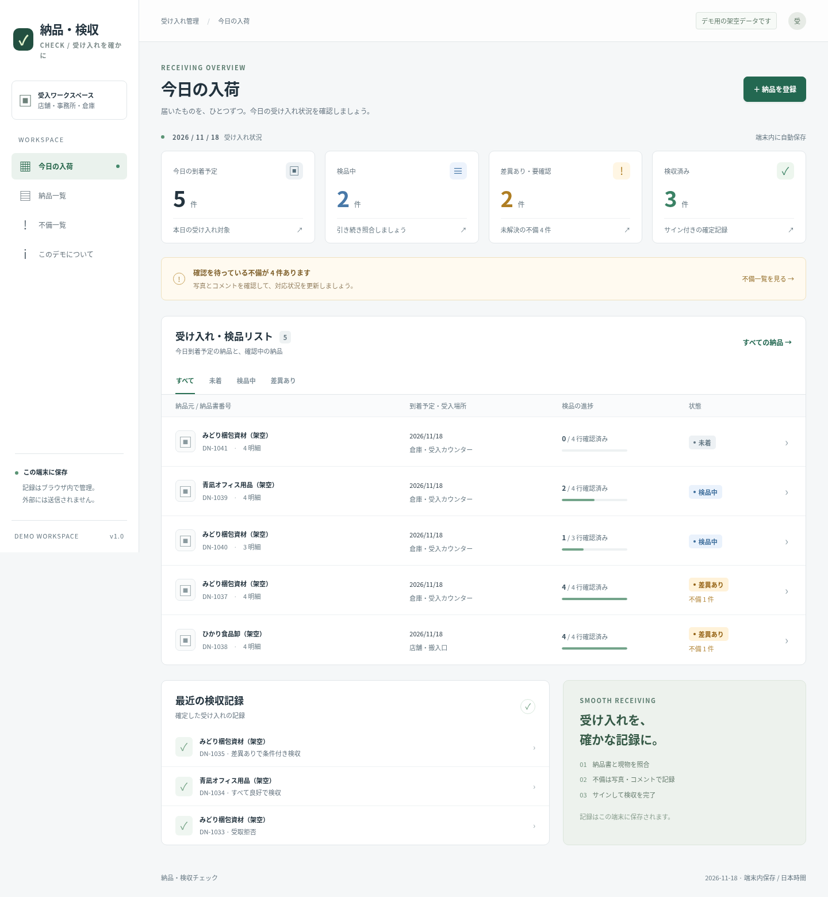

# 納品・検収チェック

## 概要

小さな店舗・事務所・工場の受け入れ担当者が、納品書と現物を照合するスマホ中心のPWAです。
数量と状態を確認し、不備の証拠を残して、手書きサインで検収記録を確定します。
金額・単価・税・合計金額は扱いません。デモ用の架空データです。

## 主な機能

1. **納品明細に対する検品チェック**
   - 明細ごとの「OK（数量一致・良好）」、実数の増減・直接入力、状態・コメント。
   - 不足・過剰の自動判定、確認済み行数と不備件数の進捗表示。
   - 納品登録・編集・削除、明細追加・削除・並べ替え、納品元と品目の入力補助。
   - 「前回と同じ明細で作成」、状態・納品元・期間による絞り込み。
2. **不備写真とコメント**
   - 1行最大3枚。カメラ撮影・画像選択に対応。
   - ブラウザ内で長辺1280px・JPEG品質0.7に縮小し、IndexedDBに保存。
   - 写真の拡大・削除、返品・再納品依頼などの対応方針、対応状況の管理。
   - 全納品の不備を未解決優先で一覧表示し、元の納品に移動。
3. **検収者のサインと完了記録**
   - CanvasとPointer Eventsによる指・マウスの手書きサイン。
   - 全行確認・検収者名・サインを必須とし、日本時間の検収日時を自動記録。
   - 確定後は明細・写真・サインをロック。対応状況だけ更新可能。
   - 理由必須の取り消し・再検品と、旧検収情報を保持する履歴。
   - SHA-256の「記録の指紋」、記録を開く際の再照合、写真の変更・欠落の検出。
   - 印刷・PDF保存、検収済み一覧、明細単位のBOM付きCSV。

## 既存作品との違い

| 既存作品                     | 既存作品が扱う範囲                | 本作が扱う範囲                       |
| ---------------------------- | --------------------------------- | ------------------------------------ |
| 見積・受注・請求管理システム | 見積・受注・請求・金額計算        | 届いた現物と納品書の数量・状態の照合 |
| 請求書・見積書作成ツール     | 請求書・見積書の作成と税計算      | サイン付きの検収記録                 |
| 入金消込マネージャー         | 入金と請求の照合・消込            | 入荷時の数量差異・状態不良           |
| 発注・仕入管理システム       | 発注作成・承認・仕入先管理        | 発注番号を参照用の文字列として保持   |
| 在庫管理システム             | 在庫増減・棚卸                    | 受け取った時点の検品記録             |
| 配送・配車管理システム       | 配送ルート・配車・ドライバー側POD | 受け取る側の検品・検収               |
| 保守・点検管理システム       | 設備点検・異常・修理              | 納品物の不備と対応状況               |

## 画面一覧

| パス                      | 画面                                       |
| ------------------------- | ------------------------------------------ |
| `/`                       | 今日の入荷・件数カード・最近の検収記録     |
| `/deliveries`             | 納品一覧・新規登録・絞り込み・CSV          |
| `/deliveries/[id]`        | 明細の検品・写真・コメント                 |
| `/deliveries/[id]/sign`   | 検収結果・サイン・確定                     |
| `/deliveries/[id]/record` | 検収記録・指紋照合・印刷・取り消し         |
| `/issues`                 | 不備一覧・対応状況更新                     |
| `/about`                  | デモ説明・保存先・データリセット・写真容量 |

## データの保存先とPWA

- 納品・明細・不備情報・サイン・検収記録・取り消し履歴：localStorage（`dic:v1`）。
- 写真：IndexedDB（`dic-photos`）。写真本体はlocalStorageに保存しません。
- スキーマを検証し、壊れた保存データは通知して既定データに戻します。
- 初回とリセット時にシードを生成します。以降は端末の記録を復元します。
- 写真は1枚約100〜400KBが目安です。画像によりサイズは変わります。
- リセットは写真・サインも再生成。全写真削除は確定記録の参照を保持し、写真欠落を表示します。
- ブラウザのデータ消去で記録は失われます。必要な記録はPDF・CSVとして保存してください。
- 認証・外部API・クラウドDB・メール送信はありません。

本番環境でのみService Workerを登録します。一度開いた画面と静的ファイルをキャッシュし、
オフライン時に「オフライン（この端末に保存されます）」を表示します。
未訪問の画面はオンラインで先に開いてください。開発環境では登録しません。
更新時には`public/sw.js`の`VERSION`を更新すると旧キャッシュを削除します。
ホーム画面への追加は対応ブラウザのメニューから行います。
Web Crypto・Service Workerの利用にはHTTPSまたはlocalhostが必要です。

## 技術スタック

- Next.js 16 / App Router / TypeScript / React 19
- Tailwind CSS 4のプロジェクト構成、画面別に分割したCSS
- ESLint、Node.js組み込みテストランナー（TypeScript直接読込のためNode.js 24推奨）
- localStorage / IndexedDB / Canvas / Pointer Events / Web Crypto / Service Worker
- 外部フォント・外部画像・追加のnpmパッケージは使用しません。

画面と部品は`src/components/`、判定・集計・日付・保存検証・CSV・シードなどは
`src/lib/`に分割しています。`next.config.ts`の`turbopack.root`はプロジェクト直下を指します。

## 公開URL

[https://delivery-inspection-check.vercel.app](https://delivery-inspection-check.vercel.app)

## スクリーンショット



02〜04はスマートフォン幅（390×844）、01と05はデスクトップ幅（1440px）で公開URLから撮影しています。

| 画面       | 画像                                                      |
| ---------- | --------------------------------------------------------- |
| 今日の入荷 | [01-arrivals.png](docs/screenshots/01-arrivals.png)       |
| 検品       | [02-inspect.png](docs/screenshots/02-inspect.png)         |
| 不備写真   | [03-issue-photo.png](docs/screenshots/03-issue-photo.png) |
| サイン     | [04-sign.png](docs/screenshots/04-sign.png)               |
| 検収記録   | [05-record.png](docs/screenshots/05-record.png)           |

## ローカル起動方法

このフォルダ直下で実行します。

```bash
npm install
npm run dev
```

ブラウザで`http://localhost:3000`を開きます。

```bash
npm run lint
npm run typecheck
npm test
npm run build
npm start
```

テストでは数量・状態の判定、進捗、不備抽出と絞り込み、検収可否、正規化とハッシュ、
取り消し履歴、CSV、保存データ検証、深夜・早朝・夕方・月末・年末のシードを検証します。

## デモデータについて

初回は個別に設定した10件の納品を用意しています。
未着2件・検品中2件・差異あり2件・検収済み3件・受取拒否1件、各3〜8行の明細です。
不備は5件で、うち4件に架空イラストが付きます。対応状況も未対応・連絡済み・解決を含みます。

すべて架空で、日付は開いた日時（初回・リセット時）から相対生成します。
到着日時・検収日時は生成時点より過去です。写真はアプリ内で描いた架空のイラストで、
「サンプル画像（架空）」と明記しています。検収済みのサインもアプリ内で描いた架空の線です。
実在の企業・商品・個人とは無関係です。

指紋は簡易な改ざん検知のデモであり、法的な電子署名ではありません。
対応状況を除く記録内容とサイン・写真参照を照合し、写真本体もそのハッシュと比較します。
端末の保存データと指紋を同時に書き換える操作を防ぐものではありません。
